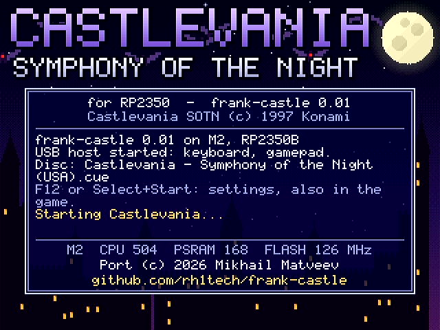
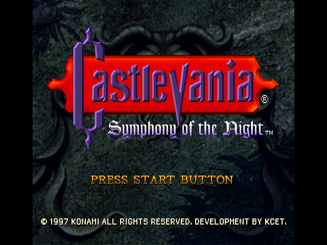
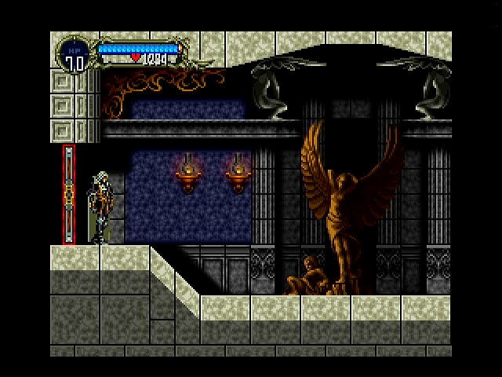
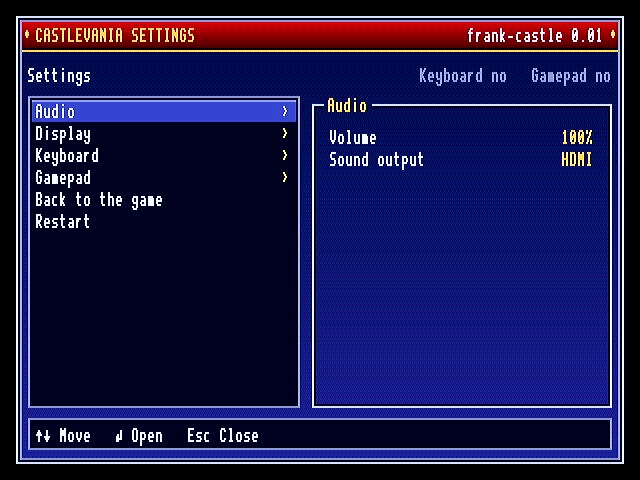
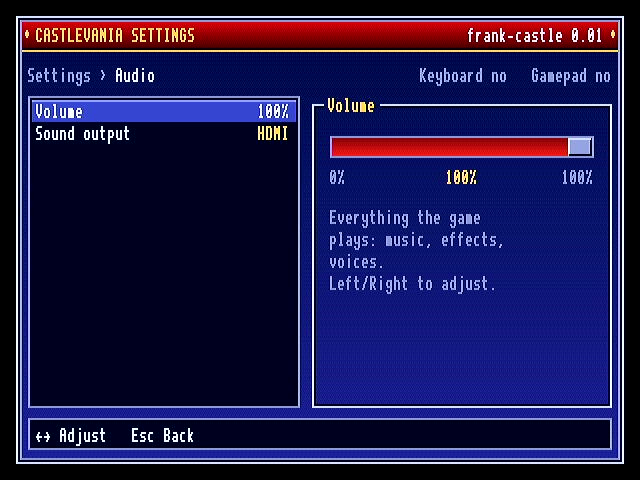
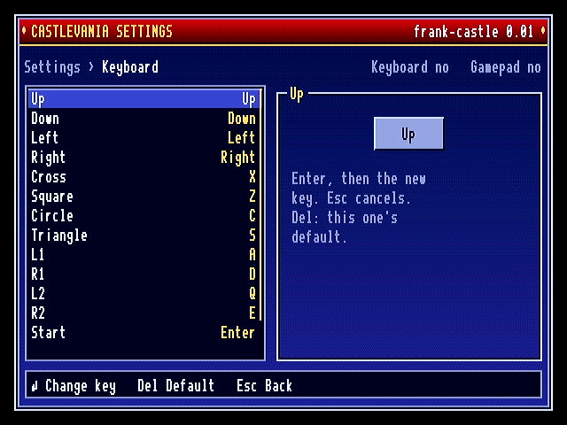
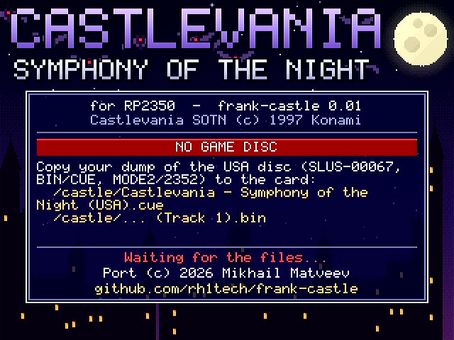

# frank-castle

Official page: **[frank.rh1.tech](https://frank.rh1.tech/)**, the hub for all
FRANK boards and firmware.

Castlevania: Symphony of the Night running on a single RP2350, on the
**[FRANK](https://frank.rh1.tech/)** M2 board: HDMI picture and sound (or an
I2S DAC), a USB keyboard or gamepad, and the game read straight from your own
disc image on the microSD card.

| Welcome screen | Title | In the castle |
|:---:|:---:|:---:|
|  |  |  |
| **Settings (F12)** | **Settings: a slider** | **Settings: key bindings** |
|  |  |  |

## The game

Castlevania: Symphony of the Night (*Akumajō Dracula X: Gekka no Yasōkyoku*)
was released by Konami for the PlayStation in 1997, directed by Toru Hagihara
with Koji Igarashi as assistant director and writer, and scored by Michiru
Yamane. It follows Rondo of Blood: in 1797 Dracula's castle rises again,
Richter Belmont has disappeared, and Alucard, Dracula's son, wakes from his
sleep to enter it.

Where the earlier games went from stage to stage, Symphony of the Night is one
large castle to explore in any order the player's abilities allow: new
powers (the mist, the bat, the double jump) open new ways, and the castle is
mapped as it is explored. Alucard gains levels, equips weapons, armour and
relics, casts spells and calls familiars. Beyond the first ending is a second,
inverted castle. With the open, ability-gated map of Super Metroid it gave the
"Metroidvania" genre its name.

The game opens with the end of Rondo of Blood, Richter's fight with Dracula in
1792, then the castle entrance, Alucard's start.

## The port

The game code is the [sotn-decomp](https://github.com/Xeeynamo/sotn-decomp)
community decompilation with [psyz](https://github.com/Xeeynamo/psyz), its PS1
library layer, built the way its PC port is
([rh1tech/sotn-decomp](https://github.com/rh1tech/sotn-decomp), branch
`rp2350`, carries the port's changes). The firmware adds a PS1 GPU rasterizer
that shares the work between both cores, the SPU mixed into the HDMI signal or
the I2S DAC, the CD-ROM and the memory cards on the microSD card, and the HDMI
output.

- 256/320/368/512-wide PS1 display modes on 640x480 at 60 Hz HDMI, with every
  one of its 32768 colours
- sound in the HDMI signal (44.1 kHz audio packets), or from the board's I2S
  DAC: a setting, switched at once
- the whole castle and the inverted castle, every boss
- saves on the card, as on a memory card
- USB keyboard and gamepads: XInput (Xbox 360/One), DualShock 4, DualSense,
  Logitech F710, common clones and generic HID pads (decoded from their report
  descriptor); every button can be rebound
- a settings window (F12), in the game and on the welcome screen
- a welcome screen at power-on (the castle at night, bats crossing the moon),
  and error screens for a missing card, a missing disc image or a fatal error
- flicker-free screens: double-buffered, flipped at vertical blank

## Hardware

- **[FRANK](https://frank.rh1.tech/)** M2 (RP2350B, 8 MB PSRAM), or a
  compatible board with the M2 layout such as the
  [Murmulator](https://murmulator.ru) M2
- 16 MB of flash (the firmware is about 14 MB)
- HDMI: GPIO 12-19 (HSTX): 12/13 clock, 14/15 D0, 16/17 D1, 18/19 D2
- microSD (SPI0): SCK 6, MOSI 7, MISO 4, CS 5
- I2S DAC (optional, HDMI sound needs none): DATA 9, BCLK 10, LRCK 11
- PSRAM: CS1 on GPIO 47
- USB keyboard or gamepad on the native USB port (a hub takes both)
- debug UART: GPIO 0/1, 115200

## Installing

1. Flash `m2p2_frank-castle_1_00.uf2` from the
   [releases](https://github.com/rh1tech/frank-castle/releases): hold
   BOOTSEL, plug the board in and copy the file to the RP2350 drive, or use
   `picotool load -f m2p2_frank-castle_1_00.uf2`.
2. Copy your dump of the USA disc (SLUS-00067, BIN/CUE, MODE2/2352) into
   `/castle/` on a FAT32 or exFAT card:

   ```
   /castle/Castlevania - Symphony of the Night (USA).cue
   /castle/Castlevania - Symphony of the Night (USA) (Track 1).bin
   ```
3. Power the board on.

No game data is included in this repository or in its releases. The game's
saves go to `/castle/bu00/`, the settings to `/castle/castle.cfg`.

When something is wrong, the welcome screen turns into an error screen:

| Screen | When | What happens |
|---|---|---|
| NO SD CARD | no readable card in the slot | waits for one |
| NO GAME DISC | no `.cue` in `/castle` | waits for a card that has it |
| AREA NOT AVAILABLE / GAME ERROR | the game cannot go on | shows why; any key restarts |



## Controls

| PS1 pad | Keyboard | Gamepad |
|---|---|---|
| D-pad | arrows | d-pad, left stick |
| Cross (jump) | X | A / cross |
| Square | Z | X / square |
| Circle | C | B / circle |
| Triangle | S | Y / triangle |
| L1 / R1 | A / D | LB / RB |
| L2 / R2 | Q / E | LT / RT |
| Start | Enter | Start |
| Select | Tab, Space | Back / Select |
| **Settings** | **F12** | **Home, or Select+Start** |
| Skip the opening (debug) | F9 | |

Gamepads are matched by button position, so cross is always the bottom
button. The game's own Button Config (System menu) maps the pad buttons to
its actions as on the PS1.

F9, a debug aid, skips the opening: on the welcome screen, the title, the file
menus or Richter's prologue it goes straight to the castle entrance,
Alucard's start (the console restarts once).

### Settings

F12 (or a gamepad's Home button, or Select+Start together) opens the settings
window. In the game it pauses everything, sound included; on the welcome
screen it opens before the game starts.

| Group | Setting | |
|---|---|---|
| Audio | Volume | 0-100% in ten steps |
| | Sound output | HDMI (default): in the HDMI signal, 44.1 kHz; I2S: the DAC. At once |
| Display | Effects | Full; Reduced when slow (default): big semi-transparent effects (light, fog) draw every other row pair while the game runs late, in play only; fades always draw whole; Always reduced |
| Keyboard | a key for each PS1 button | Enter, then the key; Del: that button's default; Restore defaults |
| Gamepad | a button for each PS1 button | the same, Y or Del for the default |
| Back to the game / Start the game | | |
| Restart | | asks first |

Up/Down (or the d-pad) move, Enter or Right (A) opens a group or changes a
value, Left/Right adjust, Esc (B) goes back and closes, PgUp/PgDn (LB/RB) move
a page, and a letter jumps to the next row starting with it. Changes are saved
to `/castle/castle.cfg` when the window closes.

## Building

You need the Pico SDK 2.2, the Arm GNU toolchain, CMake and Rust (cargo: the
decompilation's string encoder is built on the host).

```
git clone --recursive https://github.com/rh1tech/frank-castle
./build.sh                    # M2, 504 MHz CPU, 168 MHz PSRAM, 126 MHz flash
./release.sh 1.00             # release/m2p2_frank-castle_1_00.uf2
./flash.sh                    # picotool, board in BOOTSEL
./swd_flash.sh frank-castle   # or over SWD with a Debugprobe (1 MHz)
```

Options (cmake `-D...`):

- `USB_HID=OFF`: the native USB port is a USB CDC console instead of the
  keyboard host (development).
- `CPU_SPEED`, `PSRAM_SPEED`, `PSRAM_RXDELAY`, `FLASH_SPEED`, `FLASH_RXDELAY`:
  the clocks, as tuned on the M2 with the diag firmware
  (`frank-castle-diag`).
- `CASTLE_SPU_REVERB=ON`: SPU reverb (about 2 ms a frame).
- `CASTLE_ARGS`: default game arguments, e.g. `--stage nz0`;
  `/castle/args.txt` on the card overrides them.

## Development

- The debug console is UART0 on GPIO 0/1 at 115200, or the USB CDC console in
  a `USB_HID=OFF` build. `~BOOT~` reboots into BOOTSEL (then
  `tools/usb_flash.sh` loads the UF2), `~RST~` restarts.
- `tools/castle_cmd.py` drives the game over the console: `boot STAGE`, `go
  STAGE ROOM`, `stat`, pad presses; `~C menu~` opens the settings and
  `~C errtest sd|disc|game~` shows an error screen for 8 s.
- `tools/room_sweep.py`, `tools/room_perf.py`, `tools/transition_test.py`,
  `tools/save_test.py`: every room, its speed, every stage exit, a save and a
  load.
- `tools/grab.sh` grabs a frame from an HDMI capture card;
  `tools/flicker_check.py` records it and reports frames that flicker;
  `tools/shell_shots.py` takes the firmware screens' screenshots.

## Author

Mikhail Matveev <xtreme@rh1.tech>, [rh1.tech](https://rh1.tech)

## Acknowledgments

The game
- **[Konami](https://www.konami.com)**: Castlevania: Symphony of the Night
  (1997)

The game code
- **Luciano Ciccariello (Xeeynamo)** and the
  [sotn-decomp](https://github.com/Xeeynamo/sotn-decomp) contributors: the
  decompilation and its PC port
- **Xeeynamo**: [psyz](https://github.com/Xeeynamo/psyz), the PS1 libraries
  for the PC port, with its SPU

Libraries and drivers
- **Raspberry Pi Ltd**: the [Pico SDK](https://github.com/raspberrypi/pico-sdk)
  and the I2S PIO program from
  [pico-extras](https://github.com/raspberrypi/pico-extras)
- **fliperama86**: [pico_hdmi](https://github.com/fliperama86/pico_hdmi), the
  HSTX output and HDMI data islands the video driver grew from
- **Ha Thach**: [TinyUSB](https://github.com/hathach/tinyusb)
- **Ryan Wendland**: the Xbox controller driver, from
  [usb64](https://github.com/Ryzee119/usb64)
- **Fruit-Bat**: the HID report descriptor parser, from
  [pico-zxspectrum](https://github.com/fruit-bat/pico-zxspectrum)
- **drewpo28 and the pico-speccy authors**:
  [pico-speccy](https://github.com/drewpo28/pico-speccy), the gamepad
  decoders, the descriptor-decoded generic pads and the 6x10 UI font
- **ChaN**: [FatFs](http://elm-chan.org/fsw/ff/)
- **Elehobica**: the microSD SPI driver, from
  [pico_fatfs_test](https://github.com/elehobica/pico_fatfs_test)
- **Doug Lea**: [dlmalloc](https://gee.cs.oswego.edu/dl/html/malloc.html),
  the PSRAM heap

RP2350 port
- **Mikhail Matveev** ([rh1.tech](https://rh1.tech), xtreme@rh1.tech): the
  port to RP2350, the GPU rasterizer and the speed work; the board support
  and drivers from [frank-fodder](https://github.com/rh1tech/frank-fodder),
  the HDMI audio packets from
  [frank-quake2](https://github.com/rh1tech/frank-quake2), the settings window
  after [frank-idtech1](https://github.com/rh1tech/frank-idtech1)'s (from
  [frank-amiga](https://github.com/rh1tech/frank-amiga)'s prefs editor), the
  UI font by way of [frank-dino](https://github.com/rh1tech/frank-dino)

## License

frank-castle is released under the GNU Affero General Public License, version
3 or later (see `LICENSE`), inherited from sotn-decomp.

- The port's own code (`src/`, `tools/`, the board support and the drivers
  written for it) is Copyright (c) 2026 Mikhail Matveev <xtreme@rh1.tech>,
  AGPL-3.0-or-later.
- sotn-decomp and psyz (`third_party/sotn-decomp`) are AGPL-3.0-or-later, by
  their authors.
- The other parts keep the licences in their headers: GPL-3.0-or-later (the
  frank-fodder drivers, the UI font), MIT (TinyUSB code, the usb64 driver, the
  HID parser), BSD (FatFs, the microSD driver, the Pico SDK and its PIO
  programs), public domain (pico_hdmi, dlmalloc).

Castlevania and its data belong to Konami. Nothing from the game is included;
you need your own copy.
